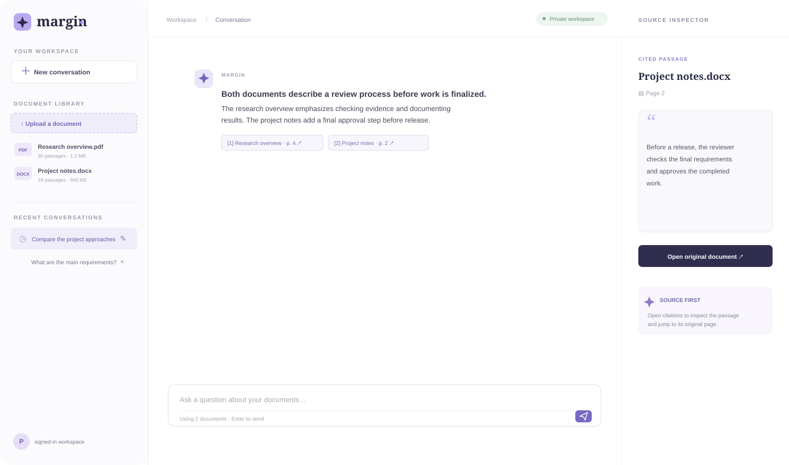

<div align="center">

# Margin

### Ask your documents. Get answers with citations.

**A deployed AI document Q&A app** built with Next.js, Node.js Route Handlers, Supabase PostgreSQL + pgvector, and OpenAI.

[**Open the live app ↗**](https://margin-qa-app.vercel.app/) · [Local setup](SETUP.md) · [Database schema](supabase/schema.sql)


</div>

---

Margin lets a signed-in user upload documents, ask questions across selected files, and inspect the source passages behind each answer. Conversation history can be reopened, renamed, or deleted.

## Interface preview

These are **illustrative previews** of the current interface, with sample document text. The live app uses the same sign-in and workspace layout.

<p align="center">
  
</p>

<p align="center">
  
</p>

## What it does

- **Private document library:** Supabase Auth protects the workspace; uploaded originals are held in private Supabase Storage.
- **Document ingestion:** Supports PDF, DOCX, TXT, and Markdown files up to 5 MB. Text is extracted and split into passages; PDF page references are preserved where available.
- **Retrieval-augmented answers:** OpenAI embeddings are stored in PostgreSQL with pgvector. For each question, the app retrieves relevant passages from the selected documents and sends that context to the answer model.
- **Visible citations:** Answers include source citations. Selecting one opens its passage in the source inspector and can open the original file.
- **Conversation history:** Questions and answers persist. Users can reopen, rename, or delete conversations.
- **Grounding behavior:** If retrieved passages do not sufficiently support an answer, the app returns its “answer unavailable” response instead of inventing a citation.

## How the request flows

| Stage | What happens |
| --- | --- |
| Upload | An authenticated API route validates the file, extracts text, splits it into passages, and stores the original in private Supabase Storage. |
| Index | The server requests embeddings from OpenAI and saves passage text, metadata, and vectors in Supabase PostgreSQL using pgvector. |
| Ask | A Node.js Route Handler embeds the question and calls the pgvector similarity-search function, limited to the conversation’s selected documents. |
| Answer | OpenAI generates an answer from retrieved passages; the app maps citations back to those passages before returning the response. |
| Save | The user and assistant messages, citations, and conversation metadata are stored for history. |

## Stack and responsibilities

| Layer | Technology | Responsibility |
| --- | --- | --- |
| Web app | Next.js App Router + React | Sign-in, document library, chat, citations, and source inspector |
| Server/API | Next.js Route Handlers running on Node.js | Authenticated REST-style endpoints for upload, indexing, chat, and conversations |
| Authentication | Supabase Auth | Account creation, sign-in, and user session tokens |
| Database | Supabase-hosted PostgreSQL + pgvector | User-scoped records, passage embeddings, and similarity search |
| File storage | Supabase Storage | Private originals accessed through authenticated app flows |
| AI | OpenAI API | `text-embedding-3-small` embeddings and `gpt-4o-mini` answer generation by default |
| Hosting | Vercel | Production deployment |

**Architecture note:** This project uses Next.js Route Handlers as its Node.js backend; it does not run a separate Express server. Supabase is the managed PostgreSQL, authentication, and storage provider. The app integrates with those services and defines its schema, access policies, and API behavior.

## Run locally

Requirements: Node.js 20.9 or newer, a Supabase project, and an OpenAI API key.

```bash
npm install
cp .env.example .env.local
npm run dev
```

On Windows PowerShell, use:

```powershell
Copy-Item .env.example .env.local
```

Before starting:

1. Run [`supabase/schema.sql`](supabase/schema.sql) in the Supabase SQL Editor.
2. Set the environment variables shown in [`.env.example`](.env.example) in `.env.local`.
3. Follow [`SETUP.md`](SETUP.md) for the detailed Supabase and deployment setup.

Then open [http://localhost:3000](http://localhost:3000). For a quick local walkthrough, upload [`examples/sample-handbook.md`](examples/sample-handbook.md) and ask: **“What must happen before a release?”**

## Limits and testing

- Maximum upload size: 5 MB per file.
- Supported formats: PDF, DOCX, TXT, and Markdown.
- Scanned/image-only PDFs do not have OCR in the current implementation.
- OpenAI is called during document indexing and question answering.

Run the available checks:

```bash
npm test
npm run check
npm run build
```

## Project structure

| Path | Purpose |
| --- | --- |
| `app/page.js`, `app/globals.css` | Sign-in, document library, chat, citations, and source inspector |
| `app/api/` | Authenticated document, chat, and conversation Route Handlers |
| `lib/extract.js`, `lib/chunk.js` | File parsing and page-aware passage splitting |
| `lib/ai.js`, `lib/indexer.js` | OpenAI embeddings, indexing, and grounded answer generation |
| `supabase/schema.sql` | PostgreSQL/pgvector schema, search function, and access policies |

---

<div align="center">

Built to make answers traceable to the documents they came from.

[**Try Margin**](https://margin-qa-app.vercel.app/)

</div>
